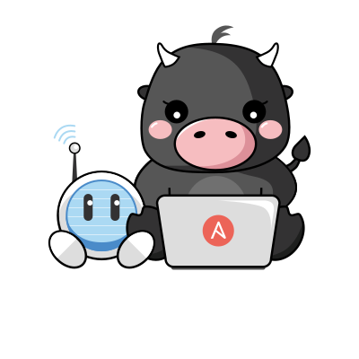
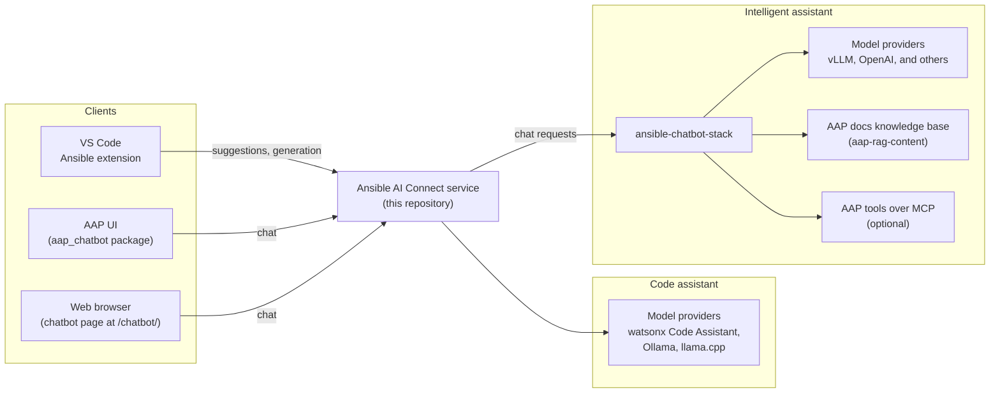

# Ansible AI Connect

Ansible AI Connect is the service behind Red Hat Ansible Lightspeed. It brings
generative AI to Ansible users in two ways:

- **Code assistant**: Ansible code suggestions, playbook generation, and
  explanations in the [Ansible VS Code extension](https://marketplace.visualstudio.com/items?itemName=redhat.ansible).
- **Intelligent assistant**: the chatbot for Ansible Automation Platform (AAP).
  This repository contains the chatbot UI and the API it talks to.

<br clear="left"/>

## How it works



- **Clients** send requests to the Ansible AI Connect service. It handles
  sign-in, permissions, and feedback.
- **Code assistant** requests go straight to a model provider.
- **Chat** requests go to
  [ansible-chatbot-stack](https://github.com/ansible/ansible-chatbot-stack).
  The stack sends the question to the model, adds matching AAP documentation
  from [aap-rag-content](https://github.com/ansible/aap-rag-content), and can
  call AAP tools through MCP servers.

## What's in this repository

| Path                                                                 | What it is                                              |
|----------------------------------------------------------------------|---------------------------------------------------------|
| [`ansible_ai_connect`](./ansible_ai_connect)                         | The service (Django) and its REST API.                  |
| [`ansible_ai_connect_chatbot`](./ansible_ai_connect_chatbot)         | Chatbot UI (React), served by the service at `/chatbot/`. |
| [`aap_chatbot`](./aap_chatbot)                                       | Chatbot UI packaged for the AAP UI, published to npm as [`@ansible/ansible-ai-connect-chatbot`](https://www.npmjs.com/package/@ansible/ansible-ai-connect-chatbot). |
| [`ansible_ai_connect_admin_portal`](./ansible_ai_connect_admin_portal) | Admin portal (React), served at `/console/`, where organization admins set the model and telemetry options. |
| [`tools/docker-compose`](./tools/docker-compose)                     | Local development environment.                          |

## Getting started

You need [Podman](https://podman.io/) with a compose provider (`podman-compose`
or `docker-compose`), and [Ollama](https://ollama.com/). To try code
suggestions, also install [VS Code](https://code.visualstudio.com/) with the
[Ansible extension](https://marketplace.visualstudio.com/items?itemName=redhat.ansible).
Run the commands below from the repository root.

1. Start a local model:

   ```bash
   export OLLAMA_HOST=0.0.0.0
   ollama serve &
   ollama pull mistral:instruct
   ```

2. Create `tools/docker-compose/.env`:

   ```bash
   DEPLOYMENT_MODE="upstream"
   SECRET_KEY="somesecretvalue"
   WCA_SECRET_BACKEND_TYPE="dummy"
   ANSIBLE_AI_MODEL_MESH_CONFIG='{"ModelPipelineCompletions": {"provider": "ollama", "config": {"inference_url": "http://host.containers.internal:11434", "model_id": "mistral:instruct"}}}'
   ```

   Keep the single quotes around the JSON. To turn on more features (playbook
   generation, explanations, chat), see the
   [model configuration examples](./docs/config/examples/README-ANSIBLE_AI_MODEL_MESH_CONFIG.md).

3. Start the service:

   ```bash
   podman compose -f tools/docker-compose/compose.yaml --env-file tools/docker-compose/.env up
   ```

   The service runs at <http://localhost:8000>. The first run builds the
   image, which needs plenty of memory. If the build fails with `SIGKILL`, see
   [Container build runs out of memory](./docs/development.md#container-build-runs-out-of-memory).

4. Connect VS Code: in the Ansible extension settings, enable
   `Ansible > Lightspeed` and `Ansible > Lightspeed: Suggestions`, and set
   `Ansible > Lightspeed: URL` to `http://localhost:8000`. The first time, also
   create the OAuth application, as described in
   [Connect VS Code](./docs/development.md#connect-vs-code).

5. Stop the service:

   ```bash
   podman compose -f tools/docker-compose/compose.yaml down
   ```

To try the chatbot, run
[ansible-chatbot-stack](https://github.com/ansible/ansible-chatbot-stack),
then set `ModelPipelineChatBot` in `ANSIBLE_AI_MODEL_MESH_CONFIG` and
`CHATBOT_DEFAULT_PROVIDER` in `.env`. The
[chatbot README](./ansible_ai_connect_chatbot/README.md) has the full steps.

## Documentation

- [Development guide](./docs/development.md): configuration, authentication,
  testing, the OpenAPI schema, dependencies, and troubleshooting.
- [Model configuration](./docs/config/examples/README-ANSIBLE_AI_MODEL_MESH_CONFIG.md)
- [Chatbot UI](./ansible_ai_connect_chatbot/README.md)
- [AAP chatbot package](./aap_chatbot/README.md)
- [Admin portal](./ansible_ai_connect_admin_portal/README.md)

## Getting help

Ask questions and report bugs in
[GitHub issues](https://github.com/ansible/ansible-ai-connect-service/issues).
To report a security issue, see [SECURITY.md](./SECURITY.md).

## Contributing

Contributions are welcome. Before you open a pull request against `main`, run
`pre-commit run -a` and the tests, and make sure CI passes. See the
[development guide](./docs/development.md#contributing) for the full workflow.

## License

Apache License 2.0. See [LICENSE](./LICENSE).
